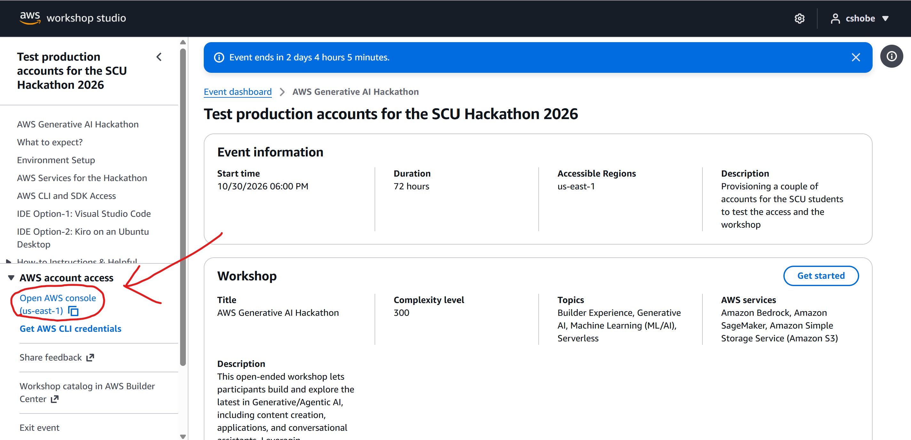
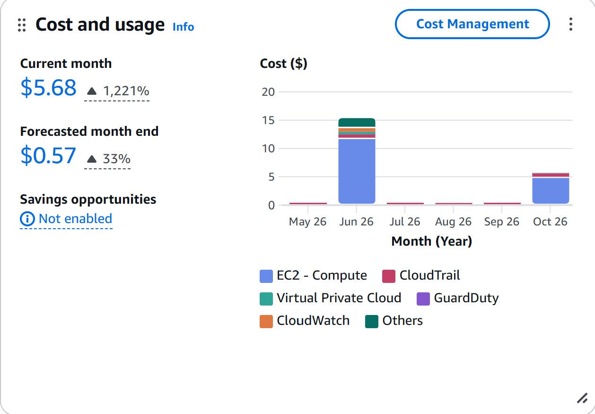
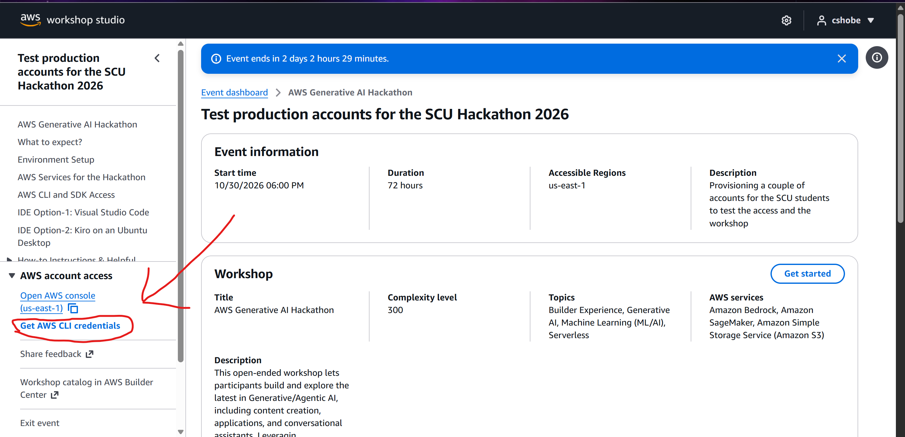
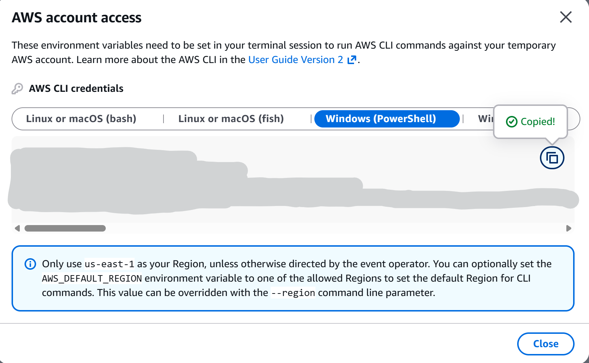
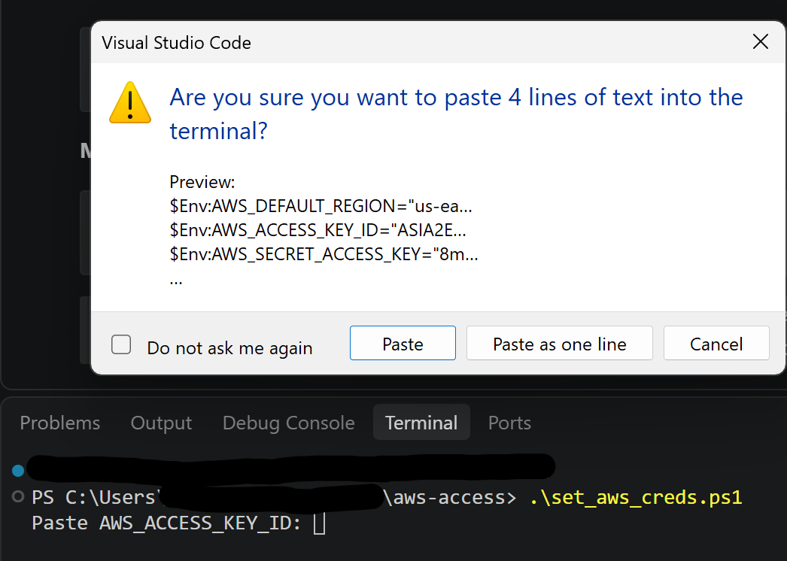
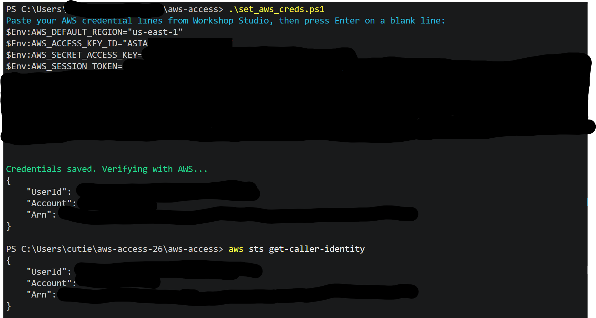
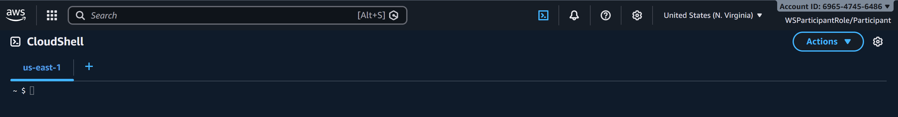
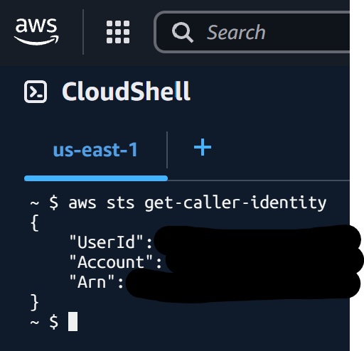

# How to Access AWS Services
> **Santa Clara University ACM - Fall AWS Hackathon**

Welcome to the SCU ACM AWS Hackathon! This guide shows you how to securely log in and access AWS services.

---

## Fundamental Hackathon Rules
1. **NO IAM Access Keys:** Do **NOT** generate long-lived IAM Access Keys. You do not need them, and creating them risks leaking secrets. The **temporary session credentials** from your Workshop Studio dashboard (used in [Option A](#option-a-local-terminal--vscode-temporary-session-keys)) are different — they come with an `AWS_SESSION_TOKEN` and expire automatically, so using those is fine.
2. **Never Call AWS Services Directly from the Frontend:** Your web application (React, Vue, iOS, HTML) should **never** contain AWS credentials or SDK calls. Frontend talks to **API Gateway**, which triggers **AWS Lambda**.
3. **Stick to One Region:** Pick **`us-east-1` (N. Virginia)** in the top-right corner of the AWS Console and create all your resources in that exact region.

---

## Table of Contents
- [1) AWS Management Console](#1-aws-management-console)
    - [1a) Logging into AWS Workshop Studio](#1a-logging-into-aws-workshop-studio)
- [2) Setting Up Your Terminal (2 Options)](#2-setting-up-your-terminal-2-options)
    - [Option A: Local Terminal / VSCode (temporary session keys)](#option-a-local-terminal--vscode-temporary-session-keys)
    - [Option B: AWS CloudShell (Zero Setup)](#option-b-aws-cloudshell-zero-setup)
- [3) Session Lifespan & Troubleshooting Lost Access (Option A Only)](#3-session-lifespan--troubleshooting-lost-access-option-a-only)
    - [Scenario A: "I opened a new terminal and it says 'Unable to locate credentials'!"](#scenario-a-i-opened-a-new-terminal-and-it-says-unable-to-locate-credentials)
    - [Scenario B: "My keys expired after a few hours!"](#scenario-b-my-keys-expired-after-a-few-hours)
    - [How to Check Your Current Session Status](#how-to-check-your-current-session-status)
    - [How to Regenerate Fresh Keys](#how-to-regenerate-fresh-keys)
- [4) Kiro Credits](#4-kiro-credits)

---

## 1) AWS Management Console
Before jumping into the code, you need to get into your team's AWS account. Workshop Studio gives each of you access to it, along with your own temporary credentials — there's no need to create any users yourself.

### 1a) Logging into AWS Workshop Studio
Every team is provided with a temporary AWS environment for the duration of the hackathon. You do **not** need a credit card. **Every person on the team must join individually** — one person joining does **not** give the rest of the team access.

1. Go to **[judging.scuacm.com](https://judging.scuacm.com)** and sign in with the link we emailed you
2. Open **Your team** — you'll see your team's **AWS workshop join link** and **access code**
3. Click the join link
    - If the link doesn't work, go to **[catalog.us-east-1.prod.workshops.aws/join](https://catalog.us-east-1.prod.workshops.aws/join)** and enter the access code from that same team page when asked
4. Select **Email one-time password (OTP)**
5. Enter your **SCU Email Address** (`@scu.edu`) — **not** a personal Gmail
    - Signing in with a personal address puts you outside your team's environment. There is no error message, so you won't notice until you go looking for something a teammate created
6. Check your inbox for the 6-digit passcode, enter it, accept the Terms & Conditions, and click **Join event**
7. On the Event Dashboard, go to the sidebar and click **Open AWS Console** in the **AWS account access** section



**Note**: You do not need a credit card. If you see billing charges, make sure you are in the provided workshop account — not a personal AWS account.



## 2) Setting Up Your Terminal (2 Options)
To run AWS CLI commands or deploy infrastructure, choose **one** of the options below.

### Option A: Local Terminal / VSCode (temporary session keys)
*SCU ACM recommends this option. This is best for learning how to develop locally on your laptop.*

1. Install the AWS CLI if you haven't already. Open the terminal in VS Code and run the command for your OS:

**Windows (PowerShell):**
```powershell
winget install Amazon.AWSCLI
```

**Mac:**
```shell
brew install awscli
```

**Linux:**
```shell
sudo apt install awscli
```

After installing, **close and reopen your VS Code** before continuing.

2. Return to your **AWS Workshop Studio Dashboard** browser tab (where you clicked "Open AWS Console")
3. Click the button labeled **Get AWS CLI commands / AWS CLI Credentials**

4. Copy the entire credentials block from Workshop Studio, then run the script for your OS. Right-click to paste the block into the terminal when prompted, then press **Enter** on a blank line to finish.

**Windows (PowerShell):**
```powershell
.\set_aws_creds.ps1
```

**Mac / Linux:**
```shell
bash set_aws_creds.sh
```

Make sure you have this repo cloned and that your terminal is in the correct directory (most likely `aws-access-26`, the name of this repo unless you renamed it). The screenshot shows `aws-access` without the `26` from when this was originally tested. If you get a prompt asking whether it is okay to paste multiple lines of text into the terminal, click **Yes**.


Once the script completes, it will print **"Credentials saved. Verifying with AWS..."** followed by your `UserId`, `Account`, and `Arn`. You can verify at any time by running `aws sts get-caller-identity` and confirming the same values appear.


> **What the script does:** accepts the full credentials block you paste, applies them to your current terminal, and saves them to your shell profile so every new terminal window is authenticated automatically. Re-run it whenever Workshop Studio shows a new set of keys.

5. **Preventing leaks**: These session tokens **auto-expire** every few hours — they are never written to your code.

### Option B: AWS CloudShell (zero setup)

*This is best for fast deployments, CLI testing, and if you do not want to install tools locally.*

1. Look at the top-right navigation bar inside the AWS Console
2. Click the **`[>_]` CloudShell icon**
3. A browser-based terminal will open

4. **CloudShell comes pre-authenticated as your user with Python and the AWS CLI installed.** You can run commands immediately without any additional configuration.
5. Verify your active identity in CloudShell by typing `aws sts get-caller-identity` into the terminal


## 3) Session Lifespan & Troubleshooting Lost Access (Option A Only)
Because session keys are **time-bound**, they will eventually expire. Your work is never lost — you just need to grab fresh keys from Workshop Studio.

### Scenario A: "I opened a new terminal and it says 'Unable to locate credentials'!"
The script saves credentials to your shell profile, so new terminals should load them automatically. If a new terminal is not picking them up, VS Code may need to be restarted to apply the changes.

**The Fix:** Close and reopen VS Code, then verify with `aws sts get-caller-identity`

If that still does not work, re-run the credential script with your current keys.

### Scenario B: "My keys expired after a few hours!"
Workshop Studio session keys are designed to auto-expire for security.

**What happens:** The temporary session token is no longer valid

**The Error:** `An error occurred (ExpiredToken) when calling the operation: The provided token has expired`

**The Fix:** Follow the Regenerate Fresh Keys steps below

### How to Check Your Current Session Status
Run these two commands in your terminal to see if your keys are still active:

#### 1. Check if keys exist in your shell memory
```shell
# Mac / Linux
printenv | grep AWS

# Windows (PowerShell)
Get-ChildItem Env:AWS_*
```

*If this prints nothing, your terminal forgot the keys (Scenario A).*

#### 2. Test if the token is valid with AWS
```shell
aws sts get-caller-identity
```

**Success Output:** Returns your temporary `UserId` and `Account`. You can continue coding!

**Failure Output (ExpiredToken):** Your session timed out (Scenario B)

### How to Regenerate Fresh Keys
If your session expired:
1. Return to your open **AWS Workshop Studio Dashboard** browser tab
2. Click **Get AWS CLI commands / AWS CLI Credentials**
3. Copy the new credentials block and re-run the script (`.\set_aws_creds.ps1` or `bash set_aws_creds.sh`), pasting the new values when prompted
4. Verify by running `aws sts get-caller-identity` in your terminal

## 4) Kiro Credits
Every participant also gets their own **Kiro** code worth **1000 credits**. Kiro is an AI coding IDE from AWS.

- Find your code by signing in at **[judging.scuacm.com](https://judging.scuacm.com)** and opening **Your team** — the same page as your AWS workshop join link. Each person sees only their own code; it is **not** shared with your team
- The redemption link is right next to your code
